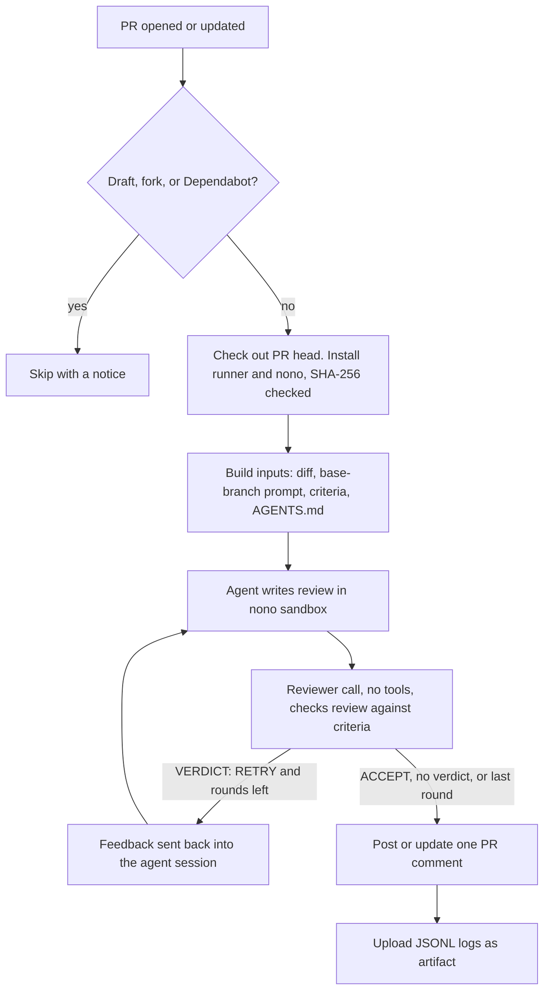

# Unreal Agent PR Review

A GitHub Action that reviews pull requests with
[Unreal Agent](https://github.com/unreallabsai/unreal-agent) and posts the review as a PR comment.
The agent runs inside a [nono](https://github.com/nolabs-ai/nono) sandbox. It cannot change files,
reach the network, or read the API key.

Listed on [GitHub Marketplace](https://github.com/marketplace/actions/unreal-agent-pr-review).

For a ready-made workflow, use the reusable workflow or the template in
[ianchov/unreal-agent-pr-review](https://github.com/ianchov/unreal-agent-pr-review).

## Usage

```yaml
name: Unreal Agent PR review
on:
  pull_request:
    types: [opened, synchronize, reopened, ready_for_review]

permissions:
  contents: read
  pull-requests: write

jobs:
  review:
    runs-on: ubuntu-24.04
    timeout-minutes: 60
    concurrency:
      group: unreal-agent-review-${{ github.event.pull_request.number }}
      cancel-in-progress: true
    steps:
      - uses: ianchov/unreal-agent-pr-review-action@v1
        with:
          anthropic-api-key: ${{ secrets.ANTHROPIC_API_KEY }}
```

1. Add the repository secret `ANTHROPIC_API_KEY` (Settings → Secrets and variables → Actions).
2. Add the workflow above as `.github/workflows/unreal-agent-review.yml`.
3. Open a pull request from a branch in the same repository.

The action checks out the PR head itself. Do not add a separate checkout step.

## Inputs

| Input | Default | Meaning |
|---|---|---|
| `anthropic-api-key` | required | Anthropic API key. |
| `model` | `claude-sonnet-5-5` | Anthropic model for the agent and the reviewer check. |
| `max-review-rounds` | `3` | Most agent and reviewer-check rounds per run. |
| `review-timeout-minutes` | `40` | Time limit for all review rounds. The runner has no timeout for each model request. |
| `diff-exclude` | empty | Extra paths to leave out of the diff, one git pathspec per line, for example `app/staticfiles`. Common lockfiles are always left out. |

## Outputs

| Output | Meaning |
|---|---|
| `status` | Reviewer-check result, for example `Passed the reviewer check.`. Empty when the PR was skipped. |
| `skipped` | `true` when the PR was skipped: draft, fork, or Dependabot. |

## Runner requirements

- Linux on amd64 or arm64, with Landlock (Linux 5.13 or later).
- Debian or Ubuntu: `dpkg`, `apt-get`, and passwordless `sudo` to install nono.
- `git`, `curl`, `jq`, `gh`, and `timeout`. GitHub-hosted Ubuntu runners have all of them.

## Custom prompt, criteria, and rules

The action reads these files from the PR's **base** branch. A file missing there falls back to the
default in [`defaults/`](defaults).

| Path in your repository | Purpose |
|---|---|
| `.github/unreal-agent/pr-review.md` | Review task: inputs, method, output format. |
| `.github/unreal-agent/review-criteria.md` | Criteria that the reviewer check applies to the review. |
| `AGENTS.md` | Repository rules. The agent checks each change against them. |

Edit the prompt and the criteria together. The criteria must match the output format that the prompt
asks for. Changes take effect only after they merge into the base branch.

## How it works



- **One comment.** The action finds its own comment by a hidden marker and updates it on each push.
- **Logs.** All JSONL event logs and the final review go to the `unreal-agent-review-<PR>` artifact.
  The job summary shows the review and token totals.

## Security model

- **Trusted inputs come from the base branch.** The prompt, criteria, and `AGENTS.md` are read
  with `git show $BASE_SHA:...`, so a PR cannot weaken its own review.
- **Author text is data, not task.** The PR title and description go into read-only files.
  The task text only names their paths and marks them untrusted.
- **Four directories.** The agent's workspace and the inputs are read-only. The session store is
  the only writable grant besides `/tmp`. The task, criteria, logs, and review sit in a directory
  the sandbox cannot see, so the agent cannot change anything a later step trusts.
- **The workspace is not the checkout.** The runner loads `.env` and `.harness/skills` from its
  workspace, so the workspace is an empty directory. The checkout is a separate read-only path.
- **The key never enters the sandbox.** nono holds `ANTHROPIC_API_KEY` in its proxy and gives the
  sandbox a session token. The proxy allows only `POST /messages` on `api.anthropic.com`.
  Landlock blocks all other connections.
- **Skipped PRs.** Drafts, fork PRs, and Dependabot PRs are skipped. Fork and Dependabot PRs get no
  secrets, and drafts still change. The action runs only on `pull_request` events and fails on
  any other event, including `pull_request_target`.
- **Pinned downloads.** `unreal-agent-runner` and nono are pinned in
  [`scripts/install.sh`](scripts/install.sh) and checked against their release SHA-256 sums.
- **Least privilege.** The job needs only `contents: read` and `pull-requests: write`.
  The checkout does not keep credentials.

## Versions

`@v1` follows the latest `v1.x.y` release. To pin exactly, use a full commit SHA.

[`scripts/install.sh`](scripts/install.sh) pins the `unreal-agent-runner` and nono release tags and
the SHA-256 sum of each architecture's download.

## Updating pinned versions

Renovate opens a PR when Unreal Agent, nono, or a GitHub Action has a new release. For Unreal Agent
and nono it updates the tag and both SHA-256 sums in `scripts/install.sh`. Renovate waits 3 days
after each release. It merges minor and patch updates on its own once `Install check` passes on
both architectures. Review and merge major updates by hand.

If `Install check` fails with curl exit code 22 (HTTP error), the release renamed its files. Update
the asset name in the `scripts/install.sh` table on the PR branch. Unreal Agent did this between
v0.2.0 and v0.3.1.

## Releases

When a merged Renovate PR changes `action.yml`, `scripts/`, or `defaults/`, the `Release` workflow
publishes the next patch release (for example `v1.1.0` → `v1.1.1`) and moves `v1` to it.

Release other changes by hand:

1. Create the next `v1.x.y` release from `main` and publish it to GitHub Marketplace.
2. The `Move major tag` workflow then moves `v1` to it.

Workflows that use `@v1` get a change only after its release.

## License

MIT. See [LICENSE](LICENSE).
