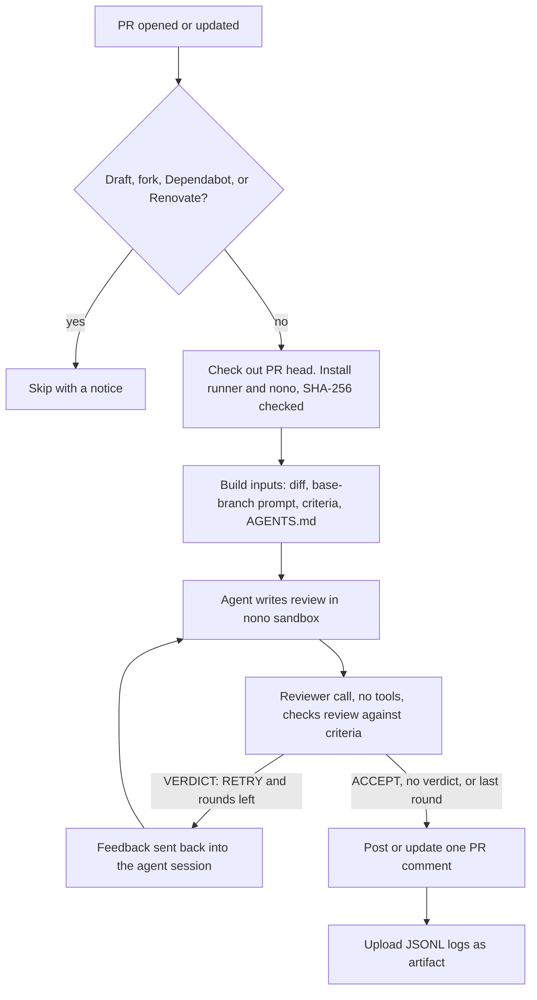

# Unreal Agent PR Review

A GitHub Action that reviews pull requests with
[Unreal Agent](https://github.com/unreallabsai/unreal-agent) and posts the review as a PR comment.
The agent runs inside a [nono](https://github.com/nolabs-ai/nono) sandbox. It cannot change files,
reach the network, or read the API key.

Listed on [GitHub Marketplace](https://github.com/marketplace/actions/unreal-agent-pr-review).

For a ready-made workflow, use the reusable workflow or the template in
[ianchov/unreal-agent-pr-review](https://github.com/ianchov/unreal-agent-pr-review).

## Usage

```yaml
name: Unreal Agent PR review
on:
  pull_request:
    types: [opened, synchronize, reopened, ready_for_review]

permissions:
  contents: read
  pull-requests: write

jobs:
  review:
    runs-on: ubuntu-24.04
    timeout-minutes: 60
    concurrency:
      group: unreal-agent-review-${{ github.event.pull_request.number }}
      cancel-in-progress: true
    steps:
      - uses: ianchov/unreal-agent-pr-review-action@v1
        with:
          anthropic-api-key: ${{ secrets.ANTHROPIC_API_KEY }}
```

1. Add the repository secret `ANTHROPIC_API_KEY` (Settings → Secrets and variables → Actions).
   For OpenAI or OpenRouter, see [Model providers](#model-providers).
2. Add the workflow above as `.github/workflows/unreal-agent-review.yml`.
3. Open a pull request from a branch in the same repository.

The action checks out the PR head itself. Do not add a separate checkout step.

### Model providers

`provider` picks the model API: `anthropic` (default), `openai`, or `openrouter`. Pass the key of
that provider in its own input. `model` uses the provider's model names. It defaults to
`claude-sonnet-5-5` for `anthropic` and `openai/gpt-6-sol` for `openrouter`, and is required for
`openai`:

```yaml
      - uses: ianchov/unreal-agent-pr-review-action@v1
        with:
          provider: openrouter
          openrouter-api-key: ${{ secrets.OPENROUTER_API_KEY }}
```

| `provider` | Key input | API the proxy allows |
|---|---|---|
| `anthropic` | `anthropic-api-key` | `POST https://api.anthropic.com/v1/messages` |
| `openai` | `openai-api-key` | `POST https://api.openai.com/v1/responses` |
| `openrouter` | `openrouter-api-key` | `POST https://openrouter.ai/api/v1/responses` |

### Adversarial review

`review-mode: adversarial` runs a second kind of review. The agent reviews the change as three
hostile personas: Saboteur, New Hire, and Security Auditor. Each persona reports at least one
finding, and a finding that two or more personas raise moves up one severity level. The adversarial
review posts its own comment and its own `unreal-agent-review-<PR>-adversarial` artifact. The action
uses fixed paths under `$RUNNER_TEMP`, so run each mode in its own job. The example below runs the
adversarial review only when the standard review has a verdict and no P0 or P1 finding, and passes
the standard review with `prior-review` so the adversarial review does not repeat it. Otherwise
`skip-reason` skips the adversarial review and marks its old comment as not reviewed for this commit:

```yaml
jobs:
  review:
    runs-on: ubuntu-24.04
    timeout-minutes: 60
    concurrency:
      group: unreal-agent-review-${{ github.event.pull_request.number }}
      cancel-in-progress: true
    outputs:
      verdict: ${{ steps.review.outputs.verdict }}
      highest-severity: ${{ steps.review.outputs.highest-severity }}
    steps:
      - id: review
        uses: ianchov/unreal-agent-pr-review-action@v1
        with:
          anthropic-api-key: ${{ secrets.ANTHROPIC_API_KEY }}
  adversarial:
    needs: review
    if: ${{ !cancelled() && (needs.review.result == 'success' || needs.review.result == 'failure') }}
    runs-on: ubuntu-24.04
    timeout-minutes: 60
    concurrency:
      group: unreal-agent-review-${{ github.event.pull_request.number }}-adversarial
      cancel-in-progress: true
    steps:
      - if: >-
          needs.review.outputs.verdict != ''
          && !contains(fromJSON('["P0","P1"]'), needs.review.outputs.highest-severity)
        uses: actions/download-artifact@v8
        continue-on-error: true
        with:
          name: unreal-agent-review-${{ github.event.pull_request.number }}
          path: ${{ runner.temp }}/standard-review
      - uses: ianchov/unreal-agent-pr-review-action@v1
        with:
          anthropic-api-key: ${{ secrets.ANTHROPIC_API_KEY }}
          review-mode: adversarial
          prior-review: ${{ runner.temp }}/standard-review/review.md
          skip-reason: >-
            ${{ needs.review.outputs.verdict == '' && 'the standard review gave no verdict'
            || contains(fromJSON('["P0","P1"]'), needs.review.outputs.highest-severity)
              && format('the standard review found a {0} defect', needs.review.outputs.highest-severity)
            || '' }}
```

The adversarial prompt adapts the
[adversarial-reviewer skill](https://github.com/alirezarezvani/claude-skills/tree/main/engineering-team/skills/adversarial-reviewer)
by ekreloff (MIT). See [defaults/adversarial/LICENSE](defaults/adversarial/LICENSE).

## Inputs

| Input | Default | Meaning |
|---|---|---|
| `provider` | `anthropic` | Model provider: `anthropic`, `openai`, or `openrouter`. |
| `anthropic-api-key` | empty | Anthropic API key. Required for provider `anthropic`. |
| `openai-api-key` | empty | OpenAI API key. Required for provider `openai`. |
| `openrouter-api-key` | empty | OpenRouter API key. Required for provider `openrouter`. |
| `model` | `claude-sonnet-5-5` for `anthropic`, `openai/gpt-6-sol` for `openrouter` | Model for the agent and the reviewer check, in the provider's names. Required for `openai`. |
| `max-review-rounds` | `3` | Most agent and reviewer-check rounds per run. |
| `review-timeout-minutes` | `40` | Time limit for all review rounds. The runner has no timeout for each model request. |
| `diff-exclude` | empty | Extra paths to leave out of the diff, one git pathspec per line, for example `app/staticfiles`. Common lockfiles are always left out. |
| `review-mode` | `standard` | `standard` or `adversarial`. Each mode posts its own comment and artifact. Run each mode in its own job. |
| `prior-review` | empty | Path to an earlier review of the same PR, for example the standard review's `review.md`. The review then reports only defects that the earlier review does not report, and the reviewer check rejects repeats. |
| `skip-renovate` | `true` | Skip pull requests opened by Renovate (`renovate[bot]`). |
| `skip-reason` | empty | Skip this review and mark this mode's old comment as not reviewed for this commit, with this reason. |

## Outputs

| Output | Meaning |
|---|---|
| `status` | Reviewer-check result, for example `Passed the reviewer check.`. Empty when the PR was skipped. |
| `skipped` | `true` when the PR was skipped: draft, fork, Dependabot, Renovate, or `skip-reason`. |
| `verdict` | The review's verdict: `Ready to merge`, `Merge after fixes`, or `Needs rework`. Empty when skipped or when the review has no such line. |
| `highest-severity` | The most severe finding: `P0`, `P1`, `P2`, `P3`, or `none` without findings. Empty when skipped or when the review has no Findings section. |

## Runner requirements

- Linux on amd64 or arm64, with Landlock (Linux 5.13 or later).
- Debian or Ubuntu: `dpkg`, `apt-get`, and passwordless `sudo` to install nono.
- `git`, `curl`, `jq`, `gh`, `timeout`, and `python3` 3.10 or later (standard library only).
  GitHub-hosted Ubuntu runners have all of them.

## Custom prompt, criteria, and rules

The action reads these files from the PR's **base** branch. A file missing there falls back to the
default in [`defaults/`](defaults).

| Path in your repository | Purpose |
|---|---|
| `.github/unreal-agent/pr-review.md` | Review task: inputs, method, output format. |
| `.github/unreal-agent/review-criteria.md` | Criteria that the reviewer check applies to the review. |
| `.github/unreal-agent/adversarial/pr-review.md` | Same, for the adversarial review. |
| `.github/unreal-agent/adversarial/review-criteria.md` | Same, for the adversarial review. |
| `AGENTS.md` | Repository rules. The agent checks each change against them. |

Edit the prompt and the criteria of a review mode together. The criteria must match the output
format that the prompt asks for. Changes take effect only after they merge into the base branch.

## How it works



- **One comment per review mode.** The action finds its own comment by a hidden marker and updates
  it on each push. When a run starts, the comment's title changes to "reviewing commit …", and the
  last finished review moves into a collapsed "Previous review: <model>, commit …" section, so it
  is not read as the current one. The new review replaces the whole comment. If the run is
  cancelled, the comment stays like that, because no newer review exists. A run skipped with
  `skip-reason` titles it "not run for commit …" and gives the reason.
- **Logs.** All JSONL event logs and the final review go to the `unreal-agent-review-<PR>` artifact,
  or `unreal-agent-review-<PR>-adversarial` for the adversarial review.
  The job summary shows the review and token totals.
- **Cost.** The comment's last line shows the tokens and, where possible, the cost of all agent
  and reviewer calls. OpenRouter reports the cost in each response, including the provider's charge
  for a BYOK key. For Anthropic it is an estimate from the list prices in
  [`scripts/anthropic-prices.json`](scripts/anthropic-prices.json); update that file when prices
  change. Other models and OpenAI show tokens only.

## Security model

- **Trusted inputs come from the base branch.** The prompt, criteria, and `AGENTS.md` are read
  with `git show $BASE_SHA:...`, so a PR cannot weaken its own review.
- **Author text is data, not task.** The PR title and description go into read-only files.
  The task text only names their paths and marks them untrusted. An earlier review from
  `prior-review` is treated the same way, because its author read the PR text.
- **Four directories.** The agent's workspace and the inputs are read-only. The session store is
  the only writable grant besides `/tmp`. The task, criteria, logs, and review sit in a directory
  the sandbox cannot see, so the agent cannot change anything a later step trusts.
- **The workspace is not the checkout.** The runner loads `.env` and `.harness/skills` from its
  workspace, so the workspace is an empty directory. The checkout is a separate read-only path.
- **The key never enters the sandbox.** nono holds the provider's key in its proxy and gives the
  sandbox a session token. The proxy allows one host and one endpoint: `POST /messages` on
  `api.anthropic.com`, or `POST /responses` on `api.openai.com` or `openrouter.ai`. Only the key
  of the chosen provider reaches the review step. Landlock blocks all other connections.
- **Skipped PRs.** Drafts, fork PRs, and Dependabot PRs are skipped. Fork and Dependabot PRs get no
  secrets, and drafts still change. Renovate PRs are skipped too unless `skip-renovate` is `false`.
  The action runs only on `pull_request` events and fails on any other event, including
  `pull_request_target`.
- **Pinned downloads.** `unreal-agent-runner` and nono are pinned in
  [`scripts/install.sh`](scripts/install.sh) and checked against their release SHA-256 sums.
- **Least privilege.** The job needs only `contents: read` and `pull-requests: write`.
  The checkout does not keep credentials.

## Development

The shell scripts in [`scripts/`](scripts) run git, gh, and nono. The logic they share lives in
[`scripts/unreal_review.py`](scripts/unreal_review.py): provider settings, the review and
reviewer-check verdicts, the usage and cost line, and the note on an outdated comment. Run its
tests and lint with uv:

```sh
uv run pytest -q
uv run ruff check scripts tests
```

The `Test` workflow runs the same checks on every pull request.

## Versions

`@v1` follows the latest `v1.x.y` release. To pin exactly, use a full commit SHA.

[`scripts/install.sh`](scripts/install.sh) pins the `unreal-agent-runner` and nono release tags and
the SHA-256 sum of each architecture's download.

## Updating pinned versions

Renovate opens a PR when Unreal Agent, nono, or a GitHub Action has a new release. For Unreal Agent
and nono it updates the tag and both SHA-256 sums in `scripts/install.sh`. Renovate waits 3 days
after each release. It merges minor and patch updates on its own once `Install check` passes on
both architectures. Review and merge major updates by hand.

If `Install check` fails with curl exit code 22 (HTTP error), the release renamed its files. Update
the asset name in the `scripts/install.sh` table on the PR branch. Unreal Agent did this between
v0.2.0 and v0.3.1.

## Releases

When a merged Renovate PR changes `action.yml`, `scripts/`, or `defaults/`, the `Release` workflow
publishes the next patch release (for example `v1.1.0` → `v1.1.1`) and moves `v1` to it.

Release other changes by hand:

1. Create the next `v1.x.y` release from `main` and publish it to GitHub Marketplace.
2. The `Move major tag` workflow then moves `v1` to it.

Workflows that use `@v1` get a change only after its release.

## License

MIT. See [LICENSE](LICENSE).
